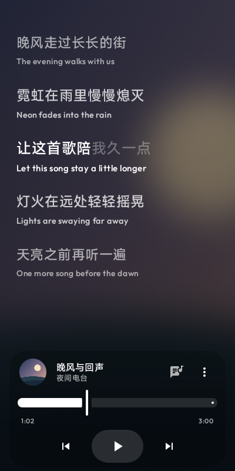
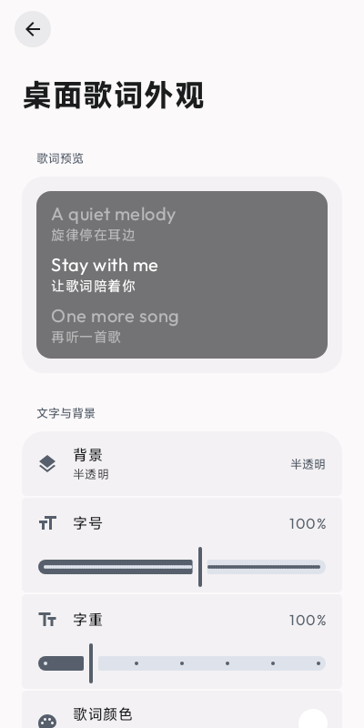
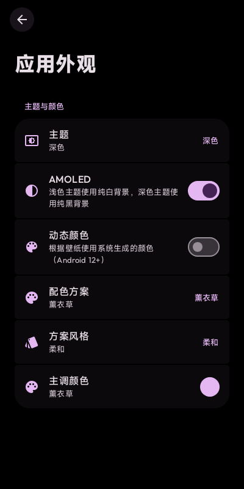
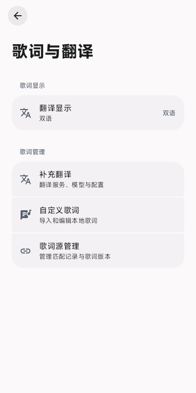

  

# 桌面歌词

**播放器不用换，给听歌补上悬浮歌词。**

Android 独立歌词工具 · 多源歌词查找 · 悬浮显示 · 双语与外观自定义

[下载正式版 APK](https://github.com/LuoH-AN/lyrics-android/releases/latest) · [安装与常见问题](docs/guide/getting-started.md) · [反馈问题](https://github.com/LuoH-AN/lyrics-android/issues)

Android 8.0+ · 64 位 ARM（arm64-v8a）· 无需 Root

喜欢某个第三方音乐播放器，却总觉得歌词体验差一点？「桌面歌词」不替代你常用的播放器，而是读取它通过 Android 系统媒体会话提供的歌曲信息，从 **QQ 音乐、网易云音乐和 LRCLIB** 查找歌词，让你在应用里看，也能悬浮在其他应用上方看。

歌在你常用的播放器里放，歌词在这里慢慢走。

## 它能帮你做什么

- **回消息、刷网页，也能看歌词**：把歌词留在悬浮小窗里，拖到顺手的位置；支持位置锁定、透明背景、颜色和渐变调整。
- **给常用播放器补上歌词**：自动按歌曲信息查找多个歌词源；匹配不合适时，可以管理歌词版本、导入自己的 LRC 或调整时间偏移。
- **在主页专心看、跟着唱**：专辑封面铺成背景，歌词随播放滚动；有逐字时间轴时支持逐字高亮，播放器支持跳转时可点击歌词重听一句。
- **外语歌也能对照看**：显示歌词源已有的译文；缺少译文时，可主动开启离线翻译或配置自己的翻译 API。
- **调成自己的样子，分享喜欢的一句**：自定义字号、字重、行间距、对齐与滚动动效，选择浅色、深色、AMOLED 或动态配色；长按歌词可复制摘句或生成分享卡片。

> 播放器需要通过系统媒体会话提供歌曲信息和播放进度。歌词、译文和逐字效果取决于歌词源，不保证每首歌都有，也不代表兼容所有播放器。详见[兼容性与反馈](docs/guide/getting-started.md#兼容性与反馈)。

## 看看界面

| 封面歌词主页 | 桌面歌词外观 | 应用主题配色 | 歌词与翻译 |
| :---: | :---: | :---: | :---: |
|  |  |  |  |

*四张图由当前应用界面渲染，主页歌曲和歌词为示例内容；桌面歌词外观图是设置预览，不是跨应用实机演示。点开图片可以看大图。*

## 装好就听

1. 打开[最新版下载页](https://github.com/LuoH-AN/lyrics-android/releases/latest)，展开 **Assets**，下载名称以 `arm64-v8a.apk` 结尾的文件。`Source code` 是源码，不是安装包。
2. 安装并打开「桌面歌词」，按提示授予**通知使用权**；使用悬浮歌词还需要**悬浮窗权限**。
3. 在常用播放器里播放一首歌，回到「桌面歌词」查看歌词。
4. 点主页控制栏「⋯」左侧的歌词按钮，开启悬浮歌词，再切到其他应用试试。更多设置位于「⋯ → 设置」。

需要 **Android 8.0 及以上、64 位 ARM 设备**和可用的 Android System WebView。目前不提供 iOS、32 位 ARM 或 x86 安装包。首次使用遇到不显示、不同步或后台消失，请看[安装与常见问题](docs/guide/getting-started.md)。

想更快开关小窗，可在「设置 → 权限与后台」添加系统下拉快捷开关。详见[歌词外观与双语显示](docs/guide/lyrics-display.md)。

## 权限与联网，先说清楚

- **通知使用权**：用于访问播放器公开的媒体会话，读取歌曲信息、封面、播放状态和进度；当前实现不处理通知正文，不使用麦克风录音识曲。
- **悬浮窗权限**：用于把歌词显示在其他应用上方；主动开启的小窗通过前台服务运行。
- **联网查词**：为查找歌词、封面和必要的歌曲别名，会向歌词平台或 Apple iTunes Search API 发送歌曲名称、歌手等信息；检查更新会访问 GitHub。自定义 LRC 保存在本机，不会作为文件上传到歌词平台。
- **可选翻译**：补充翻译默认关闭。离线翻译需要先联网下载语言包；API 翻译会把缺少译文的歌词文本（也可能来自自定义 LRC）发送给你配置的服务，可能产生费用。

更完整的数据处理说明见应用内「设置 → 关于 → 隐私说明」；首次使用前也可阅读[权限与联网说明](docs/guide/getting-started.md#权限与联网说明)。

## 一起把它用顺手

遇到问题，欢迎[提交反馈](https://github.com/LuoH-AN/lyrics-android/issues/new?template=bug_report.md)，附上应用版本、播放器及版本、手机系统、复现步骤；歌词匹配问题再加歌名、歌手和版本（如 Live、翻唱）。截图和日志请先去掉通知内容、账号与密钥。

如果它刚好解决了你的问题，欢迎分享给使用同类播放器的朋友，或给仓库点个 Star。需要介绍项目时，可参考[介绍文案与录屏脚本](docs/community/sharing.md)，只展示自己实测过的效果。

更多文档：[安装与常见问题](docs/guide/getting-started.md) · [歌词查找](docs/guide/lyrics-search.md) · [歌词外观与翻译](docs/guide/lyrics-display.md) · [开发与发布](docs/development/releasing.md)

## 从哪里来

由 [LuoH-AN](https://github.com/LuoH-AN) 继续开发，最初来自 [Tcrrrry](https://github.com/tcrrry)（B站 @Tcrrrry）的 [desktop-lyrics](https://github.com/tcrrry/desktop-lyrics)。感谢原作者，也欢迎来 [LINUX DO](https://linux.do/) 交流。

Compose 页面组件参考并移植自 [Agora](https://github.com/newo-ether/Agora)，保留其 [GPL-3.0 许可](app/src/main/kotlin/com/luoh/music/lrc/ui/agora/LICENSE)；迁移说明见 [Agora Compose 页面迁移](docs/agora-compose-migration.md)。

其余新增内容采用 [CC BY-NC 4.0](https://creativecommons.org/licenses/by-nc/4.0/deed.zh-hans) 协议（署名、非商业使用）；上游及第三方代码保留原有声明。
