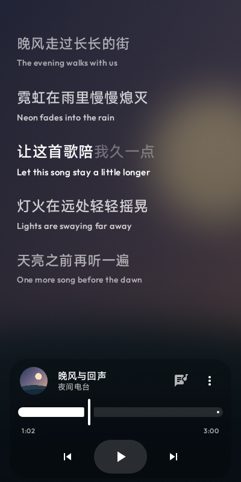
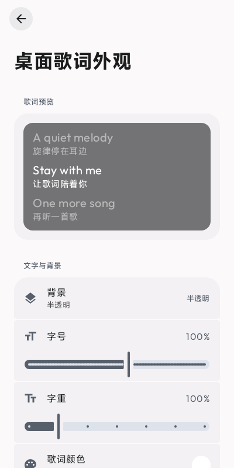
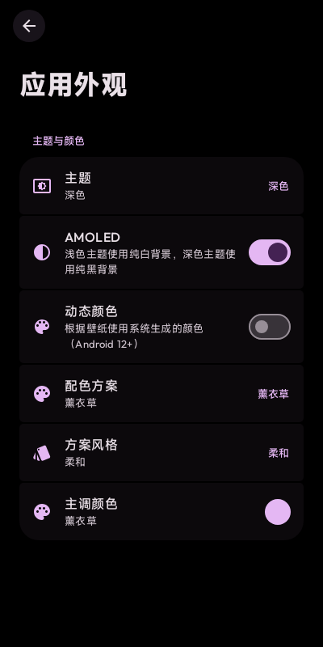
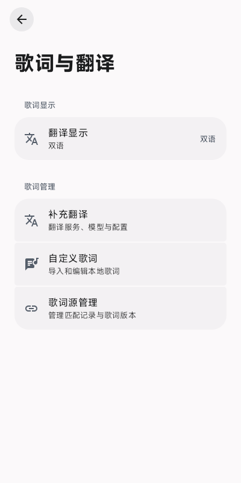

  

# 桌面歌词

歌在你常用的播放器里放，歌词在这里慢慢走。

[下载正式版](https://github.com/LuoH-AN/lyrics-android/releases/latest) · [反馈问题](https://github.com/LuoH-AN/lyrics-android/issues)

打开主页，专辑封面铺成背景，歌词跟着音乐滚动。有逐字时间轴的歌，唱到哪里，就亮到哪里。碰到想重听的一句，点一下歌词就能跳过去。

回消息、刷网页时，把歌词留在桌面小窗里，拖到顺手的位置。主页的播放控制栏也能下滑收起来，留下圆形封面、环形进度和歌曲信息；点封面播放或暂停，上滑再展开。

下拉系统快捷设置，也能直接开关桌面歌词。碰到喜欢的几句，长按歌词摘句，复制文字或生成分享卡片：专辑封面轻轻模糊成背景，左上是歌名和音乐人，中间是歌词，右下留一枚小图标。译文可以选择附带。

| 封面歌词主页 | 桌面歌词外观 | 应用主题配色 | 歌词与翻译 |
| :---: | :---: | :---: | :---: |
|  |  |  |  |

*四张图由当前应用界面渲染，主页歌曲和歌词为示例内容。点开图片可以看大图。*

## 调成自己喜欢的样子

封面背景会在播放时轻轻移动，切歌时淡入。喜欢干净的纯色页面，也可以把它关掉。浅色、深色、AMOLED、壁纸动态颜色和黑白灰都能选；字号、字重、行间距、对齐方式，以及歌词滚动的缓动、错位、缩放和模糊，也都可以自己调。

听外语歌时，可以把原文和译文放在一起看。歌词源有译文就直接用；没有的话，再选择下载离线翻译语言包，或接入自己的翻译 API。两种补充翻译都需要主动开启。

歌词会从 QQ 音乐、网易云音乐和 LRCLIB 查找，主页和小窗共用缓存。搜不到的歌，可以导入自己的 LRC；时间对不上，可以调偏移；想换歌词版本，可以去歌词源管理里挑。

## 装好就听

1. [下载 APK](https://github.com/LuoH-AN/lyrics-android/releases/latest)，安装后按提示授予通知使用权；使用桌面小窗还需要悬浮窗权限。
2. 在常用的音乐播放器里放一首歌，回到这里看歌词。
3. 想把歌词放到桌面，点主页控制栏「⋯」左侧的歌词按钮。其他调整都在「⋯ → 设置」里。

需要 **Android 8.0 及以上、64 位 ARM 设备**和 Android System WebView。播放器要能通过系统媒体会话提供歌曲信息。小窗被系统清理时，可以放宽应用的后台省电限制。

更多细节：[歌词查找](docs/guide/lyrics-search.md) · [歌词外观与翻译](docs/guide/lyrics-display.md) · [反馈问题](https://github.com/LuoH-AN/lyrics-android/issues)

## 从哪里来

由 [LuoH-AN](https://github.com/LuoH-AN) 继续开发，最初来自 [Tcrrrry](https://github.com/tcrrry)（B站 @Tcrrrry）的 [desktop-lyrics](https://github.com/tcrrry/desktop-lyrics)。感谢原作者，也欢迎来 [LINUX DO](https://linux.do/) 交流。

Compose 页面组件参考并移植自 [Agora](https://github.com/newo-ether/Agora)，保留其 [GPL-3.0 许可](app/src/main/kotlin/com/luoh/music/lrc/ui/agora/LICENSE)；迁移说明见 [Agora Compose 页面迁移](docs/agora-compose-migration.md)。

其余新增内容采用 [CC BY-NC 4.0](https://creativecommons.org/licenses/by-nc/4.0/deed.zh-hans) 协议（署名、非商业使用）；上游及第三方代码保留原有声明。
